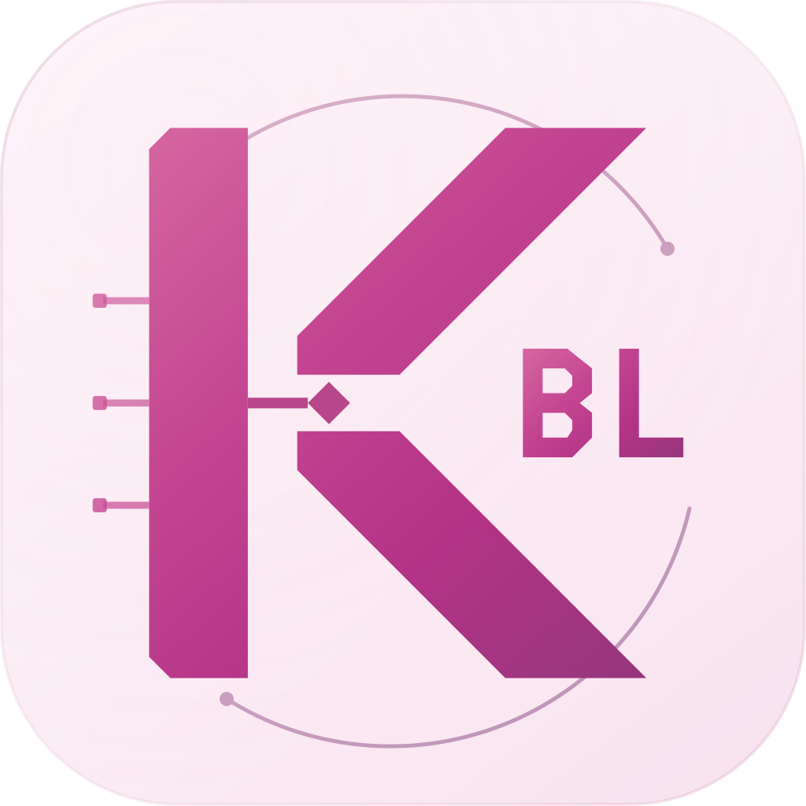

<div align="center">
  
  <h1>KernelBL</h1>
  <p><a href="https://qm.qq.com/q/8ax2kPeghy">QQ群：941336897</a> · <a href="https://t.me/blroot">Telegram：blroot</a></p>
  <p><strong>A tiny kernel in bootloader</strong><br>在 bootloader 中运行的微内核</p>
  <p><a href="#中文">中文版</a> · <a href="#english">English</a> · <a href="https://github.com/hawyn2018/KernelBL/releases">Releases</a></p>
</div>

## 功能介绍 · Features

**KernelBL（KBL）** 是运行在 ARM64 bootloader / UEFI 环境中的轻量协作式运行时。它沿用当前异常级（EL），提供引导阶段的交互命令台、文件与分区访问、程序运行和固件调试接口。只有显式请求才启动 KBL；ADB 另由显式命令启用。

**KernelBL (KBL)** is a small cooperative runtime inside an ARM64 bootloader / UEFI environment. It stays at the current exception level and provides an interactive console, file and partition access, program execution, and firmware debugging interfaces. KBL and its ADB transport are started explicitly.

| 能力 / Capability | 功能 / What it provides |
| --- | --- |
| 同 EL 运行 / Same-EL execution | 保持固件执行上下文，读取实际 CurrentEL / Retains the firmware context and measures CurrentEL |
| Fastboot 命令台 / Fastboot console | 启动、接管、状态查询、停止；退出终端保留环境 / Start, attach, status, stop; detaching retains the environment |
| 显式 ADB / Explicit ADB | `kbladb` 后提供 Shell、push、pull / Shell, push and pull after `kbladb` |
| 一核心、多会话 / One core, multiple sessions | 独立会话状态，共享 RAMFS 和挂载 / Per-session state, shared RAMFS and mounts |
| 文件与分区 / Files and partitions | VFS、按名访问、`dd`、SHA-256、二进制回读 / VFS, named partition access, `dd`, SHA-256 and binary readback |
| 文件系统 / Filesystems | FAT/exFAT、ext2/3/4；有限 F2FS 覆盖写；EROFS/LZ4 读取 / FAT/exFAT, ext2/3/4; limited F2FS overwrite; EROFS/LZ4 reads |
| 原生程序 / Native programs | KBL ABI ARM64 ELF、C 源码移植、`./program` / KBL ABI ARM64 ELF, C source porting, `./program` |
| UEFI 应用 / UEFI applications | `efi`；兼容镜像支持 `efi -bl` 临时 bootloader 路径 / `efi`; `efi -bl` for a compatible image's temporary bootloader route |
| 显示与电源 / Display and power | 显式亮灭屏、状态查询和关机 / Explicit screen control, status and shutdown |
| 驱动适配 / Driver adaptation | UEFI、块设备、USB、可执行内存及板级接口 / UEFI, block, USB, executable-memory and board interfaces |

<a id="中文"></a>
## 中文版

[English →](#english)

### 1. 项目与运行条件

这是 **KernelBL 1.0.0 独立源码版**，来源为 hnubl 2.9.2 中的 KBL。项目版本与 hnubl、Freedom / fakebl 分别管理，原有 KBL 数字 ABI 1 保持。

使用前，需要集成方把驱动和命令入口接入兼容的 ARM64 UEFI / bootloader。构建 `kbl_driver.efi` 只生成驱动文件，下载源码或运行电脑端包装器不会自动给原厂 bootloader 注册 KBL。此仓库提供运行时、平台接口和父引导桥接源码；ABL 功能定位与镜像集成由外部工具完成。

这是固件环境下的协作式运行时。Linux/Android 系统调用、完整 POSIX Shell、动态链接器和普通 Android 可执行文件属于不同环境。原生程序使用 KBL SDK；UEFI 应用使用独立的 PE/COFF 入口。同 EL 程序需主动 yield，程序异常或持续占用执行器会影响已启动的环境。

### 2. 启动、连接、接管与停止

电脑准备 Python 3、原生 Android platform-tools 和对应 USB 驱动。将 `SERIAL` 替换为设备序列号，`FASTBOOT_EXECUTABLE` 替换为原生 Fastboot 路径；单设备可省略 `-s SERIAL`。在仓库根目录执行：

```text
python tools/kbl_console/kbl_console.py --kbl-native FASTBOOT_EXECUTABLE -s SERIAL oem kblstart
```

真实会话建立后，包装器显示 `# ` 提示符。原生 Fastboot 只完成一次 OEM 事务，持续交互由本仓库电脑端提供。Windows 也可进入 `tools/kbl_console/` 使用 `./fastboot.cmd`（PowerShell）或 `fastboot.cmd`（CMD）；`KBL_FASTBOOT` / `KBL_PYTHON` 分别指定原生工具与 Python。

| 命令 | 行为 |
| --- | --- |
| `fastboot oem kblstart` | 创建 KBL；不主动启用 ADB。包装器随后进入命令台 |
| `fastboot oem kbladb` | 显式启用 ADB；尚无 KBL 时先创建环境。该命令本身是一次性请求 |
| `fastboot oem kblin` | 接管已有环境及未完成任务，不隐式启动新环境 |
| `fastboot oem kblstatus` | 查询设备报告的环境、会话和状态 |
| `fastboot oem kbloff` | 停止 KBL，同步并按生命周期回收资源 |

已接入的父固件也可将 `kblstop` 注册为 `kbloff` 的别名。上表的 `fastboot` 可使用原生工具或本仓库包装器。显式 ADB 连接：

```text
python tools/kbl_console/kbl_console.py --kbl-native FASTBOOT_EXECUTABLE -s SERIAL oem kbladb
adb -s SERIAL shell
```

ADB 启用时可能发生 USB 重枚举。普通 Fastboot 仍走原路径；同步 EFI 应用和长事务执行期间，其他请求可能排队或超时。

电脑端 `exit`、`quit`、`:detach`、Ctrl+C / EOF 仅断开终端，环境保留；再次 `kblin` 接管。ADB Shell 内 `kbl off` 或 Fastboot 的 `kbloff` 才停止整个环境、关闭各会话。同步、快照或异步资源仍忙时按状态保留资源，避免强制释放。

### 3. 命令、文件与分区回读

先输入 `help` 查看命令。常用命令包括 `el`、`pwd`、`ls`、`cd`、`mkdir`、`touch`、`cat`、`cp`、`mv`、`rm`、`echo`、`stat`、`sha256sum`、`wc`、`head`、`tail`、`grep`、`hexdump` / `xxd`、`basename`、`dirname`、`printf`、`dd`、`sync`、`mount`、`umount`。`grep` 是字面量匹配；解析器支持引号、反斜杠，管道、重定向、后台与变量展开等完整 Shell 语法另有区别。选项详见 [native 命令说明](runtime/native/README.md)。

冒号命令由电脑端处理：

```text
:help
:status
mkdir /tmp
:push "LOCAL_FILE" /tmp/example.bin
sha256sum /tmp/example.bin
hexdump -n 256 /tmp/example.bin
:pull /tmp/example.bin "NEW_LOCAL_FILE"
:pullpart PARTITION_NAME "NEW_LOCAL_PARTITION_IMAGE"
:detach
```

`:push` 验证长度和 SHA-256 后保存，不自动执行。`:pull` 使用不可变 RAMFS 快照；`:pullpart LABEL LOCAL` 或 `:pull /dev/block/by-name/LABEL LOCAL` 使用真实分区流并核对前后长度、SHA-256 和本地结果。设备需实际提供对应的二进制 `fetch` 能力；已有目标文件不会被覆盖。

ADB 启用后可用 `adb push LOCAL /tmp/file`、`adb pull /tmp/file LOCAL`、`adb shell ls /dev/block/by-name`。分区路径由平台提供者暴露为 `/dev/block/by-name/LABEL`。

`dd if=PATH of=PATH bs=N count=N skip=N seek=N conv=fsync` 在 RAM、分区和挂载文件间复制；默认 `bs=512`，复制至 EOF，`skip` / `seek` 以 `bs` 为单位。数字支持十进制、十六进制及 K/M/G 二进制单位，转换项支持 `fsync`、`notrunc` 及其组合。默认普通文件输出可截断；F2FS 已有范围覆盖应显式使用 `conv=notrunc,fsync`。失败报告已确认字节，不自动重放写入。先用 RAM 文件验证程序与参数，再访问实际分区。

### 4. 挂载与文件系统范围

```text
mkdir /mnt
mount -t fat -o rw /tmp/fat.img /mnt
ls /mnt
sync
cd /
umount /mnt
```

`mount SOURCE TARGET` 自动识别格式，默认 `rw`；只读加 `-o ro`。目标为已存在的空 RAMFS 目录，来源可为固定容量原始文件系统 RAM 镜像或平台暴露的分区。

| 文件系统 | 当前范围 |
| --- | --- |
| FAT12/16/32、exFAT | 在实现支持范围内读写 |
| ext2/3/4 | 支持特性内的 clean 文件系统读写 |
| F2FS | 读取；健康一致文件系统中已有文件的已分配范围或 inline 字节覆盖写；新建、扩展、截断、删除等返回 ENOSYS |
| EROFS | 显式只读，LZ4 压缩读取；`rw` 请求返回 EROFS |

挂载内文件可通过 `adb pull` 读取。导出 RAM 镜像前先成功卸载，再 `:pull`；对同一来源使用原生 Fastboot flash/erase 前，也先关闭文件并卸载。`efisp` 中原始 PE 镜像本身并非文件系统。

Android sparse、super/LP 映射、dm-default-key、FBE 和硬件密钥解封装需要额外实现；当前通用接口不自动解密 Android `/data`。详见 [挂载参考](runtime/fs/MOUNT.md)、[F2FS 写入范围](runtime/fs/F2FS-WRITE.md)。

### 5. 多会话、程序与 EFI 应用

执行 `kbladb` 后可打开多个 `adb shell`，同时 `adb push` / `adb pull`。Shell 的工作目录、命令、输出和句柄归属独立，RAMFS 与 mount 表共享；会话数量按内存扩展。任务由一个执行器按 FIFO 协作调度。普通 Fastboot 命令台使用默认管理会话，多个 Fastboot 窗口不等于多个独立 Shell。

原生程序采用 AArch64 ELF64 ET_DYN / KBL ABI，使用 `-mgeneral-regs-only`、`-ffixed-x18`，经 SDK 访问参数、输出、yield、CurrentEL 及支持的文件/内存接口。C `main()` 源码可从移植层开始适配：

```text
:push "build/kbl-sdk/program.kbl" /tmp/program.kbl
cd /tmp
./program.kbl hello
```

UEFI 应用使用 `LoadImage → LoadOptions → StartImage`：

```text
:push "build/kbl-efi/return.efi" /tmp/return.efi
efi /tmp/return.efi hello
efi -bl /tmp/candidate.img
efi --bootloader /tmp/candidate.img
```

`efi PATH` 保留原行为；`-bl` / `--bootloader` 只为本次加载的兼容 ABL / EFISP **RAM 副本**按功能关系选择 bootloader 路径，源文件和物理分区保持原值。选项放在路径前。无效结构、目标缺失或歧义会在执行前报告错误。子 EFI 应用同步运行，返回后恢复队列；接管 USB、重启或 ExitBootServices 的应用可能改变当前环境。

默认 RAMFS、ELF、EFI 文件容量按实际分配能力决定；PE/协议字段宽度、整数溢出和结构边界仍按格式检查。Fastboot 单次 DATA 保留真实的 32 位长度字段，更大传输需使用支持的流式路径。详见 [程序 SDK](runtime/sdk/README.md)、[C 移植层](runtime/compat/README.md)、[会话与 EFI 应用](runtime/uefi/KBL-SESSIONS-APPS.md)。

### 6. 屏幕与电源

```text
fastboot oem screenoff
fastboot oem screenon
fastboot oem screenstatus
```

这些完整 OEM 命令显式加载显示服务，不创建 KBL 或启用 ADB。Shell 中也可直接用 `screenoff`、`screenon`、`screenstatus`。操作使用真实 UEFI 显示电源协议；缺失提供者或操作失败时返回真实状态。

Shell 内 `poweroff` 先同步文件系统与块设备，再请求 UEFI Shutdown；它与关闭 KBL 环境的 `kbloff` 不同。实际关机会断开传输，主机不自动重发，平台电源行为需单独验证。

### 7. 从源码构建

使用 Python、Clang 和 LLD，独立于 Android Gradle。已验证 Windows、Python 3.12、NDK r29 LLVM；验证依赖固定在 `requirements-dev.txt`。LLVM 选择顺序为 `--llvm-bin`、`LLVM_BIN`、`PATH`，参数填写工具的 `bin` 目录。

```text
python -m pip install -r requirements-dev.txt
python verify_source.py
python build_kbl.py driver --llvm-bin LLVM_BIN_DIRECTORY
python build_kbl.py all --llvm-bin LLVM_BIN_DIRECTORY
```

默认输出 `build/`，通过 `--output` 调整。各目标如下：

| 目标 | 主要输出（相对于 build） |
| --- | --- |
| `driver` | `kbl-driver/kbl_driver.efi` |
| `parent` | `kbl-parent/parent.bin` 与 manifest |
| `recovery` | `boot-recovery/recovery.bin` 与 manifest |
| `sdk-demo` | `kbl-sdk/program.kbl` |
| `sdk-port` | `kbl-port/program.kbl` |
| `efi-apps` | `kbl-efi/return.efi`、`protocols.efi` |
| `bundle` | 新构建驱动与 `kbl-resources/` 资源及摘要 |
| `all` | 上述全部目标 |

编译自己的程序：

```text
python runtime/sdk/build_demo.py --llvm-bin LLVM_BIN_DIRECTORY --source YOUR_SOURCE.c --output build/my-program
python runtime/sdk/build_port.py --llvm-bin LLVM_BIN_DIRECTORY --source YOUR_MAIN.c --output build/my-port
```

父引导/恢复构建器默认仅生成本地二进制，外部集成方需要 Kotlin 资源时显式使用各自的 `--kotlin-output`。构建入口不访问设备、不刷写分区。

### 8. 驱动适配与源码导航

从 [驱动适配说明](driver_adapter/README.zh-CN.md)、[adapter.h](driver_adapter/adapter.h) 和 [板级模板](driver_adapter/board_template.c) 开始。实现真实的内存分配/释放、CurrentEL 和需要的平台回调，按 ABI/长度前缀传入对象；协议、上下文、事件与 DMA 资源需在借用期间保持有效。

原生路线直接桥接 `kbl_native_backend` / `kbl_handle`；已有固件服务路线使用 `kbl_service_protocol`。集成工具按当前镜像的功能、命令、协议、缓冲区和数据流关系定位入口，不使用机型、版本或绝对地址适配表。模板中未实现能力保持明确缺失/失败，新平台 USB、DMA、权限与回收行为需完成真实适配。

| 接口 | 源码 |
| --- | --- |
| 控制器、后端 | [kbl_api.h](runtime/kbl_api.h)、[kbl_native.h](runtime/native/kbl_native.h) |
| 分区、ELF、EFI | [kbl_block.h](runtime/kbl_block.h)、[kbl_elf.h](runtime/kbl_elf.h)、[kbl_efi.h](runtime/kbl_efi.h) |
| UEFI 服务与父引导 | [kbl_service.h](runtime/uefi/kbl_service.h)、[kbl_parent_shim.h](runtime/uefi/kbl_parent_shim.h) |
| USB 与分区提供者 | [kbl_usb.h](runtime/uefi/kbl_usb.h)、[kbl_usb_native.h](runtime/uefi/kbl_usb_native.h)、[kbl_partition.h](runtime/uefi/kbl_partition.h) |
| SDK 与移植层 | [runtime/sdk/](runtime/sdk/)、[runtime/compat/](runtime/compat/) |
| 电脑控制台与协议 | [tools/kbl_console/](tools/kbl_console/)、[KBL_PROTOCOL.md](tools/kbl_console/KBL_PROTOCOL.md) |

### 9. 验证范围

独立提取已完成七个构建目标以及控制器、Fetch、ELF、UEFI 驱动、USB 模型和适配层的对应主机/ARM64 仿真验证，摘要见 [VALIDATION.json](VALIDATION.json)。适配层 smoke 覆盖 53 项检查。此次独立发布保留运行时 C、头文件、汇编与第三方实现的来源内容。

```text
python driver_adapter/tests/run_smoke.py --output build/tests/adapter --cc HOST_CLANG
python -X utf8 -m unittest discover -s tools/kbl_console/tests -v
```

`HOST_CLANG` 需主机 C 运行库，与 ARM64 交叉编译器用途不同。其他集成测试可能需要原固件镜像、定位器 JSON 或文件系统工具，按各入口准备。主机模型、仿真通过和历史设备记录不构成新硬件移植结论。

<a id="english"></a>
## English

[中文版 ↑](#中文)

KernelBL is a freestanding AArch64 runtime for a bootloader or UEFI environment. It provides an explicit command interpreter, a RAM filesystem and shared VFS, partition access through platform providers, cooperative native programs, and optional Fastboot and USB ADB transports.

This first standalone release is derived from the KBL source snapshot shipped with **hnubl 2.9.2**. The standalone release number is separate from the existing **KBL ABI 1**. Existing service operation numbers and the documented program API prefixes are retained.

KernelBL runs in the execution environment supplied by its host. It does not boot Linux, provide the Linux syscall ABI, or turn an Android or BusyBox executable into a firmware application. Programs and providers execute with the host's privileges and must follow the documented ownership and cooperative execution contracts.

### What is included

| Directory or file | Purpose |
| --- | --- |
| `runtime/kbl_control.c`, `runtime/kbl_api.h` | Command controller, lifecycle, backend and transfer contracts. |
| `runtime/native/` | Native cooperative backend, execution stacks, RAMFS and command implementation. |
| `runtime/uefi/` | ARM64 EFI Boot Service Driver, parent shim, UEFI memory, partition, USB, display and application-launch adapters. |
| `runtime/fs/` | Shared filesystem interface and FAT/exFAT, ext-family, F2FS and EROFS adapters. |
| `runtime/sdk/` | Freestanding native program ABI, linker script and program builders. |
| `runtime/compat/` | A documented C library subset for porting `main(argc, argv)` source. |
| `runtime/examples/` | Native programs, C ports and explicit UEFI application examples. |
| `driver_adapter/` | Platform descriptor, native/service bridges, board template and host smoke tests. |
| `tools/kbl_console/` | Python Fastboot console, Windows wrapper and host protocol tests. |
| `third_party/` | Retained filesystem dependencies, licenses and provenance. |
| `SOURCE_ORIGIN.json`, `CHANGES-FROM-HNUBL.json` | Source origin and changes made for the standalone package. |
| `SOURCE-SHA256.json`, `verify_source.py` | Source inventory and integrity verification. |
| `VALIDATION.json` | Recorded build and test scope for this source package. |

The package builds independently of the hnubl Android application and its Gradle project. It provides runtime and integration sources; building `kbl_driver.efi` alone does not register commands in an arbitrary device's bootloader. The host integration must supply the relevant firmware interfaces and dispatch bindings.

### Build

The recorded standalone validation used **Windows, Python 3.12.10, and Android NDK r29 Clang/LLD**. The builders accept an LLVM `bin` directory and do not require the rest of an Android application project. LLVM must support the AArch64 ELF and Windows PE/COFF targets used by the selected build.

Install the pinned Python development dependencies and verify the source inventory:

```text
python -m pip install -r requirements-dev.txt
python verify_source.py
```

`requirements-dev.txt` records `pefile`, `pyelftools` and Unicorn versions used for validation. Unicorn is used by the emulation tests, rather than by the firmware runtime.

Run commands from the repository root. Replace `LLVM_BIN_DIRECTORY` with your LLVM `bin` directory:

```text
python build_kbl.py driver --llvm-bin LLVM_BIN_DIRECTORY
python build_kbl.py all --llvm-bin LLVM_BIN_DIRECTORY
```

Tool selection uses the explicit `--llvm-bin` argument, then `LLVM_BIN`, then `PATH`. Windows tool names with `.exe` and extension-free tool names are supported. For example:

```powershell
# Windows PowerShell
$env:LLVM_BIN = 'C:\path\to\llvm\bin'
python build_kbl.py all
```

```sh
# POSIX shell
export LLVM_BIN='/path/to/llvm/bin'
python build_kbl.py all
```

The default output root is `build/`; use `--output` to select a different output directory.

| Target | Main output below the output root |
| --- | --- |
| `driver` | `kbl-driver/kbl_driver.efi`, an ARM64 EFI Boot Service Driver. |
| `parent` | `kbl-parent/parent.bin` and its manifest, containing the position-independent parent bridge. |
| `recovery` | `boot-recovery/recovery.bin` and its manifest. |
| `sdk-demo` | `kbl-sdk/program.kbl`, a freestanding ABI example. |
| `sdk-port` | `kbl-port/program.kbl`, an ordinary C source port. |
| `efi-apps` | `kbl-efi/`, containing returning and protocol-inventory EFI examples. |
| `bundle` | `kbl-resources/`, containing the driver and SHA-256 file; the uniform builder rebuilds `driver` first. |
| `all` | All targets above. |

The parent and recovery builders produce local binaries and manifests by default. Kotlin resources are an explicit integration option:

```text
python runtime/uefi/build_parent_shim.py --llvm-bin LLVM_BIN_DIRECTORY --kotlin-output build/generated/KblParentModule.kt
python runtime/uefi/build_boot_recovery.py --llvm-bin LLVM_BIN_DIRECTORY --kotlin-output build/generated/FastbootRecoveryModule.kt
```

Without `--kotlin-output`, these scripts do not create or modify an Android `abl-efisp-core` tree. Build manifests record output hashes and source/tool information so that generated artifacts can be compared with their inputs.

### Porting the driver

Start with [`driver_adapter/README.zh-CN.md`](driver_adapter/README.zh-CN.md), [`adapter.h`](driver_adapter/adapter.h) and [`board_template.c`](driver_adapter/board_template.c).

There are two integration routes:

1. **Native backend:** link the adapter and the actual controller/native runtime into your host, supply a `kbl_driver_port`, and dispatch complete KBL commands through `kbl_driver_handle`.
2. **Existing EFI service:** load the EFI driver, obtain its `kbl_service_protocol` from the image handle that you own, and bind that service through the adapter. This route uses the existing service rather than creating a second native backend.

Initialization validates ABI and descriptor lengths and prepares the bridge. It does not start the runtime, allocate its environment, mount storage, initialize USB or start a timer. An unrelated command returns unhandled so that the host can continue its original dispatch path. The caller supplies the complete command bytes, such as `oem kblstart`, with their actual length.

The board template is a starting point, not a completed hardware port. Its unimplemented allocator returns failure. Replace it with actual platform callbacks before expecting START to succeed.

| Provider | Required behavior |
| --- | --- |
| Data allocation and release | Private aligned memory with accurate allocation failure and paired release. |
| CurrentEL | An actual measurement of the current execution level. The AArch64 template reads `CurrentEL`; other host architectures report unavailable. |
| Optional monotonic clock | A passive time source for cooperative checkpoints, not an implicit interrupt or scheduler installation. |
| Executable memory | Initial private RW/NX pages, real permission transitions, instruction-cache maintenance and correct release. Missing protection is not treated as successful W+X execution. |
| Block devices | Actual labels, sizes, permissions, byte I/O, confirmed partial progress, flush and close behavior. |
| UEFI environment and application execution | Real borrowed handles and firmware calls, with the declared result and cleanup contracts. |
| Display and shutdown | Real firmware operations; a black framebuffer is not reported as panel power-off. |
| USB | Actual event ownership, endpoint routing, DMA completion and quiescence information. |

Keep the adapter at a stable address. The copied descriptor can outlive its local initialization variable, but its `opaque` state, providers, USB sessions and borrowed service objects must remain valid until their users release them. Do not move the initialized adapter with `memcpy` and then treat it as another independent instance.

USB preparation is separate from permission to use a transaction. It does not prove TX idle or transfer ownership of DMA. The parent must implement the existing activation fences, native ACK completion, RX epoch and event-forwarding contracts. A timeout is not evidence that a controller has released a buffer.

Parent firmware addresses are inputs resolved for that particular image. Locating the command dispatcher, response functions, protocol relationships and buffers belongs to the integrator or an external patcher. This repository does not replace that work with model names, firmware-version address tables or a universal ABL patch.

For cleanup, first complete the original OFF and synchronization path. `kbl_driver_can_destroy` and `kbl_driver_destroy` retain busy objects and outstanding ownership; destroying the thin adapter does not implicitly stop, abort, power off or replay a write. See the adapter reference for the full lifetime contract.

A host C compiler with a native C runtime is used for the adapter smoke test. It has a different purpose from the ARM64 freestanding cross-compiler:

```text
python driver_adapter/tests/run_smoke.py --output build/tests/adapter --cc HOST_CLANG
```

### Startup, console and lifecycle

These examples require firmware that has already been integrated with KernelBL. The source builders and verification scripts do not deploy a driver or send device commands.

The Python console calls a separately supplied native Fastboot executable:

```text
python tools/kbl_console/kbl_console.py --kbl-native FASTBOOT_EXECUTABLE -s SERIAL oem kblstart
python tools/kbl_console/kbl_console.py --kbl-native FASTBOOT_EXECUTABLE -s SERIAL oem kbladb
python tools/kbl_console/kbl_console.py --kbl-native FASTBOOT_EXECUTABLE -s SERIAL oem kblin
```

Windows users can also use `tools/kbl_console/fastboot.cmd`. The wrapper does not replace other installed Fastboot executables.

| Operation | Effect |
| --- | --- |
| `fastboot oem kblstart` | Explicitly create the native environment. It does not enable ADB. The companion console enters a `#` prompt after validating the reported session. |
| `fastboot oem kbladb` | Create KernelBL if needed and explicitly enable its USB ADB transport. Re-enumeration may occur. |
| `fastboot oem kblin` | Attach the companion console to an existing environment or its current job. It does not silently start a missing environment. |
| `fastboot oem kblstatus` | Query the environment and transport status. |
| `exit`, Ctrl+C, EOF, `:detach` | Detach the current host terminal; the environment remains. |
| `fastboot oem kbloff`, parent-registered `fastboot oem kblstop`, or shell `kbl off` | Explicitly stop the shared native environment. Successful stop destroys its RAMFS. The `kblstop` alias requires the parent firmware binding. |

A raw Fastboot executable handles one OEM transaction; the persistent prompt and host-side interactive loop come from the Python console. Its `--kbl-no-console` option requests native command passthrough. Unrelated native Fastboot commands retain their native route.

The native backend is initialized only through the explicit startup contract. ADB has an additional opt-in boundary. Display-only OEM commands can load the display service without starting the native environment or enabling ADB. A port must preserve these boundaries in its own firmware dispatch.

#### Multiple sessions

After explicit `kbladb`, multiple `adb shell` connections can coexist with `adb push` and `adb pull`. Shells have independent current directories, command state, output and handle ownership; RAMFS and mount state are shared.

This is one cooperative executor with FIFO-serialized transactions, not a separate CPU or kernel for each terminal. A long transaction can delay other work. A custom program that never yields, or a firmware application that does not return, can prevent further progress.

Idle terminals do not keep a whole Fastboot transaction open. Nevertheless, continued Fastboot/ADB coexistence depends on the actual parent and USB port. Host tests alone do not prove a board's physical USB/DMA behavior.

#### Host transfers

Inside the companion console:

```text
:status
:push "LOCAL_FILE" /tmp/file.bin
:pull /tmp/file.bin "LOCAL_COPY"
:pullpart PARTITION_LABEL "LOCAL_PARTITION.img"
```

Create the RAMFS target directory first, for example `mkdir /tmp`. `:push` uploads and verifies a file; it does not execute it. RAMFS pull uses an immutable snapshot with size and SHA-256 checks. Partition pull is a live read and uses source checks before and after transfer; it is not a storage snapshot.

The host does not automatically resubmit a command or write after an uncertain timeout or disconnection. Reconnection uses status queries and the reported job identity. `kblpoll` output is consumptive: a response lost during disconnection may not be readable again. The transport does not promise exactly-once execution or lossless replay of all console output.

Long commands and paths use the negotiated multipart mechanisms. The small Fastboot wire frame and encoded protocol field widths still apply; they are distinct from a file-size quota. Current default RAMFS file/total quotas are unset, while an embedding caller may provide explicit quotas. Actual memory, address ranges, integer bounds, PE/ELF format rules and allocation failures remain applicable.

See [`tools/kbl_console/README.md`](tools/kbl_console/README.md) and [`KBL_PROTOCOL.md`](tools/kbl_console/KBL_PROTOCOL.md) for the exact command and transfer protocol.

### Native programs and the C port layer

Native programs are **little-endian AArch64 ELF64 `ET_DYN` images with the explicit KBL ABI note**. They are self-contained firmware programs, not ordinary Linux/Android ELF binaries. There is no Linux dynamic loader or syscall emulation.

An entry using the base callback prefix looks like this:

```c
#include "kbl_program.h"

KBL_DECLARE_PROGRAM();

int kbl_main(const struct kbl_program_api *api, void *opaque) {
    const char text[] = "hello from KernelBL\n";
    (void)opaque;
    if (!api || api->abi_version != KBL_PROGRAM_ABI ||
        api->struct_bytes < KBL_PROGRAM_API_BASE_BYTES) return 1;
    return api->write(api->host, text, sizeof(text) - 1);
}
```

Build the supplied example or a custom source:

```text
python runtime/sdk/build_demo.py --llvm-bin LLVM_BIN_DIRECTORY --output build/my-program
python runtime/sdk/build_demo.py --llvm-bin LLVM_BIN_DIRECTORY --source MY_PROGRAM.c --output build/my-program
```

The output is `program.kbl`; its extension does not determine compatibility. Upload it, then run `./program.kbl` or another explicit VFS path from a started KernelBL environment.

The supplied builds reserve X18 with `-ffixed-x18` and use `-mgeneral-regs-only`. The cooperative context preserves the documented general-purpose callee-saved registers, SP and NZCV. It does not switch FP/SIMD state, FP control registers or interrupt masks. Handwritten assembly must follow the same profile. Programs remain at the current host EL; this is not a privilege or fault-isolation boundary.

#### Versioned callback prefixes

| Prefix on AArch64 | Capability |
| --- | --- |
| 40 bytes | ABI, structure size, host context, output, cooperative yield and CurrentEL. |
| 56 bytes | `argc` and borrowed `argv`. |
| 64 bytes | Optional real borrowed UEFI environment. The EFI driver leaves the raw environment getter absent by default. |
| 136 bytes | File/VFS callbacks: open, read, write, seek, close, stat, mkdir, unlink and sync. |
| 152 bytes | Optional invocation-owned memory allocation and exact-size release. |

Check both `struct_bytes` and each optional function pointer before using a tail. A program note can declare a required minimum prefix so that an older runtime rejects it before entry. The original prefixes retain their offsets.

The ELF loader validates its load plan, entry point, permissions and self-relative relocations before entry. It rejects interpreters, external dynamic dependencies, W+X mappings, executable stacks and unsupported relocations. Only the documented self-image `R_AARCH64_RELATIVE` form is accepted. Real executable-memory protection and cache providers are required; missing protection is not converted into success.

#### Porting ordinary C source

The C port layer adapts `main(int, char **)` to ABI 1 and supplies a defined subset of allocation, string, ASCII character, integer formatting and VFS-backed file APIs:

```text
python runtime/sdk/build_port.py --llvm-bin LLVM_BIN_DIRECTORY --source runtime/examples/port_text.c --output build/port-text
python runtime/sdk/build_port.py --llvm-bin LLVM_BIN_DIRECTORY --source runtime/examples/port_copy.c --require-files --output build/port-copy
python runtime/sdk/build_port.py --llvm-bin LLVM_BIN_DIRECTORY --source runtime/examples/port_hash.c --require-files --extra-source runtime/kbl_sha256.c --output build/port-hash
```

Recompiling suitable C source is required. The layer is not a complete libc or POSIX environment: it has no `fork`, `execve`, command processor, mutable process environment or Linux system calls. Floating-point formatting and console stdin are outside the declared subset. Unsupported interfaces report errors such as `ENOSYS`.

On a runtime with the optional memory tail, new ports use invocation-owned host memory. Shorter interfaces retain the configurable private heap fallback; previously compiled programs retain their original allocation behavior. File callbacks report confirmed short I/O and errors, so callers must handle partial reads/writes. Their per-call transfer quantum is not a whole-file size limit.

See [`runtime/sdk/README.md`](runtime/sdk/README.md) and [`runtime/compat/README.md`](runtime/compat/README.md) for the complete ABI and porting contracts.

### Commands, filesystems and raw storage

The shell implements a documented command subset rather than a complete `sh`. Built-ins include:

```text
help el pwd ls cd mkdir touch cat cp mv rm echo hex stat true false exit
sha256sum wc head tail grep hexdump xxd basename dirname printf dd sync
mount umount screenoff screenon screenstatus poweroff
```

Explicit slash-containing paths invoke the KBL ELF loader. `efi` is a separate UEFI application interface described below.

Parsing supports quotes, escapes and dynamically sized argument storage. It does not provide shell expansion, pipelines, redirection, background jobs or the Linux process model. For example, `grep` performs literal byte matching with its documented options, not a general regular-expression engine; `xxd` is an alias for the supported canonical hex view.

Uncovered paths use private RAMFS. `/dev/block/by-name/LABEL` is the platform's actual partition namespace, with partition-relative offsets, actual capacity and hardware permissions. Opening raw storage does not mount, decrypt or create a filesystem. KernelBL does not silently change a medium's read-only attribute.

#### Filesystem support

| Format | Read | Write and limits |
| --- | --- | --- |
| FAT12/16/32, exFAT | Supported within the adapter's format profile. | Read/write, including supported namespace operations. |
| ext2/3/4 | Supported feature combinations. | Read/write on supported clean filesystems; no implicit repair or journal replay. |
| F2FS | Supported 4 KiB-block profile and checkpoint view. | Existing allocated file ranges and existing inline bytes only, on a clean consistent filesystem. No allocation, growth, truncate, hole filling or namespace mutation. |
| EROFS | Supported ordinary and LZ4-compressed data. | Read-only; unsupported compression/features report an error. |

`mount` defaults to read/write. Use `-o ro` explicitly for read-only access, including EROFS. Mounting does not convert, format or repair its source. F2FS encrypted, verity, compressed, immutable and append-only files are not writable through the limited overwrite implementation. The F2FS writer is not a full allocator or a power-loss transaction system.

For an initial filesystem test, use a disposable raw image in RAMFS:

```text
mkdir /tmp
mkdir /mnt
:push "LOCAL_RAW_FILESYSTEM_IMAGE" /tmp/volume.img
mount -t auto -o ro /tmp/volume.img /mnt
ls /mnt
cd /
umount /mnt
```

The mount target must be an existing empty RAMFS directory. Close handles and leave the mount before unmounting. Synchronization/unmount failures retain their error and owned resources rather than pretending success. Successful OFF destroys RAMFS and changes made to RAM-backed images; export the required files before stopping.

Android sparse transport images must first be expanded to raw images. Complete disk partition tables and Android `super`/LP metadata are not automatically expanded into logical block devices. Android metadata encryption and FBE need their actual hardware/key services and mappings; the current runtime does not decrypt Android userdata merely by mounting `metadata`, observing a Qseecom protocol, or running at the same EL.

KernelBL's internal raw paths protect mounted sources, but original native Fastboot flash/erase is not a filesystem scheduler. Close files and successfully unmount a source before changing it through another storage path. Short or uncertain writes are reported and are not blindly replayed by close, sync, unmount or OFF.

See [`runtime/fs/MOUNT.md`](runtime/fs/MOUNT.md), [`F2FS-WRITE.md`](runtime/fs/F2FS-WRITE.md) and the format-specific documentation for exact supported features and error behavior.

### Explicit UEFI application execution

```text
efi /return.efi hello
efi -bl /candidate.img
efi --bootloader /candidate.img
```

Ordinary `efi PATH [ARGS...]` passes the original file to firmware through `LoadImage`, private UTF-16 `LoadOptions`, and `StartImage`. The accepted profile is an AArch64 PE32+ `EFI_APPLICATION`. Firmware authentication remains firmware-owned.

The optional `-bl` / `--bootloader` switch prepares a supported ABL/EFISP **RAM copy** for the bootloader route using the uniquely proved boot-mode assignment. It does not rewrite the source file or a physical partition, and it is not a universal boot-mode switch for arbitrary EFI applications. Missing or ambiguous targets fail before the firmware call. The switch is recognized before the image path; later arguments remain child options.

The launcher requests no EL transition and checks the observed EL around firmware calls. Execution is synchronous and exclusive: a returning child allows queued work to continue; other sessions may wait or time out while the child runs. An application that takes over USB, exits Boot Services, boots another environment or does not return changes that environment accordingly. KernelBL does not isolate arbitrary firmware code.

Build examples with `python build_kbl.py efi-apps --llvm-bin LLVM_BIN_DIRECTORY`. `return.efi` measures EL and returns; `protocols.efi` inventories standard protocol GUIDs. Protocol presence is not evidence that an unknown vendor method or userdata decryption path works. See [`runtime/uefi/README-apps.md`](runtime/uefi/README-apps.md).

### Display and explicit shutdown

`fastboot oem screenoff`, `screenon` and `screenstatus` use an actual firmware display-power provider without creating the native environment or enabling ADB. The corresponding shell commands work after startup. Set/Get results are reported; unavailable providers fail explicitly.

Shell `poweroff` first requests synchronization and then UEFI shutdown. It is distinct from stopping KernelBL with `kbloff`. Firmware shutdown can disconnect the host before a final reply, so clients do not replay the request. The standalone package's validation does not claim physical shutdown testing.

### Validation scope

[`VALIDATION.json`](VALIDATION.json) is the source package's build/test record. The starting standalone snapshot records Windows/Python/NDK r29 builds for all seven targets and a driver byte-identical to its hnubl 2.9.2 reference:

```text
71570bc527edbecffdab4fe5cabc0e10d7b954daacc0a8e344892a7b33468a12
```

Its recorded tests include 39 controller cases, 21 fetch cases, 14 host ELF cases, 17 Unicorn ELF cases, 18 driver host cases with 908 assertions, two relocated ARM64 driver cases, three native USB model cases, 53 adapter host checks and an ARM64 adapter compilation check. The native runtime and individual filesystem/USB components also retain their own historical test instructions and scope notes.

These are different levels of evidence:

- Host tests execute real parser/controller/adapter code with modeled providers.
- ARM64 emulation executes the compiled ARM64 program or PE, while firmware, memory and I/O providers remain explicit models.
- Historical device observations apply to their recorded firmware integration. They are not acceptance results for a new board or for the unimplemented board template.

An emulated EL2 request that still measures `CurrentEL=1` is not EL2 evidence. This source package's standalone validation performs no device operation and makes no new hardware-port claim. Linux/macOS host execution is not established by the recorded Windows validation.

Some integration tests require an external firmware/parser fixture, parent-patcher generated input, a suitable native host compiler, or filesystem tools such as `mke2fs` and F2FS fixture utilities. Follow the selected test's instructions rather than treating unrestricted discovery of every historical test as a minimal build command.

### Current boundaries

- Execution is single-threaded and cooperative. Programs must yield; there is no hard preemption deadline, process isolation or fault containment for same-EL native code.
- Provider availability and correctness determine real memory protection, USB/DMA, display, storage and shutdown behavior.
- Program binaries must follow the KBL ABI and GPR-only profile; ordinary Linux/Android ELF and BusyBox binary compatibility are not supplied.
- ADB multi-session support does not make native jobs parallel, and long firmware applications can delay transport progress.
- Encrypted Android userdata, automatic logical-partition mapping, full F2FS allocation and general filesystem repair remain outside the implemented profile.
- Host reconnect logic avoids automatic write replay, but it does not promise lossless consumption of every interrupted console reply.
- This repository supplies sources and contracts for integration, not a guarantee that an arbitrary bootloader, firmware image or device port will boot.

### License and source notices

The root [`LICENSE`](LICENSE) is AGPLv3, and the new driver adapter files use `AGPL-3.0-only`. Original runtime files retain their own SPDX identifiers, copyright notices and licenses. The C port layer retains its MIT notice. Retained third-party filesystem code includes FatFs, lwext4, erofs-utils, LZ4 and the GRUB-derived F2FS material; their license and provenance files remain under `third_party/`.

Use [`THIRD_PARTY_NOTICES.md`](THIRD_PARTY_NOTICES.md) and the individual file/license records when reviewing redistribution terms. The standalone extraction does not replace upstream notices with a single blanket license assertion.


---

## 下载与发布 · Downloads and releases

首版 [v1.0.0](https://github.com/hawyn2018/KernelBL/releases/tag/v1.0.0) 附带：

- `KernelBL-v1.0.0-source.zip`：完整源码、驱动适配接口、构建入口、文档和矢量图标。
- `run_kbl_fastboot_shell.zip`：可独立解压使用的电脑端包装器、快速说明、协议说明和许可证。自行准备 Python 与原生 platform-tools，设备需已接入 KBL。
- `SHA256SUMS.txt`：两个 ZIP 的 SHA-256。

The first release includes the complete source archive and a separate host-wrapper ZIP named **run_kbl_fastboot_shell.zip**. The wrapper uses Python and your separately installed native Fastboot; it requires KBL-enabled firmware. Both archive hashes are published in SHA256SUMS.txt. See the [host quick start](tools/kbl_console/QUICKSTART.md).

## 来源、许可证与参与 · Provenance, license and contributing

项目许可证沿用 hnubl：**GNU Affero General Public License v3.0（AGPLv3）**，全文见 [LICENSE](LICENSE)。原文件的 SPDX、版权和独立许可保留，五组第三方依赖的来源与许可证见 [THIRD_PARTY_NOTICES.md](THIRD_PARTY_NOTICES.md)。新增适配层和项目文件使用 AGPL-3.0-only。

This project carries the hnubl root **GNU AGPL v3.0** license. Original file-level SPDX, copyright and separate notices remain in place; retained dependencies are documented in [THIRD_PARTY_NOTICES.md](THIRD_PARTY_NOTICES.md).

[SOURCE_ORIGIN.json](SOURCE_ORIGIN.json) 记录来源；[CHANGES-FROM-HNUBL.json](CHANGES-FROM-HNUBL.json) 记录提取调整；[KERNELBL-RELEASE.json](KERNELBL-RELEASE.json) 记录本次独立发布差异；[SOURCE-SHA256.json](SOURCE-SHA256.json) 与 `verify_source.py` 用于核验交付文件。源码包不包含 APK、签名私钥、设备运行日志或编译产物。

Provenance and source manifests record the extraction and publication changes. The release archives exclude APKs, signing keys, device runtime logs, build output and credentials. See [CHANGELOG.md](CHANGELOG.md) for the release history.

欢迎通过 [Issues](https://github.com/hawyn2018/KernelBL/issues) 和 Pull Request 反馈问题、提交驱动适配与改进。报告适配问题时，请提供编译工具版本、真实错误返回及最小复现，避免提交密钥或个人数据。讨论可加入 [QQ群 941336897](https://qm.qq.com/q/8ax2kPeghy) 或 [Telegram blroot](https://t.me/blroot)。

Issues, driver ports and pull requests are welcome. Include tool versions, actual error results and a minimal reproducer, and keep credentials and personal data out of reports. Community: [QQ 941336897](https://qm.qq.com/q/8ax2kPeghy) · [Telegram blroot](https://t.me/blroot).
